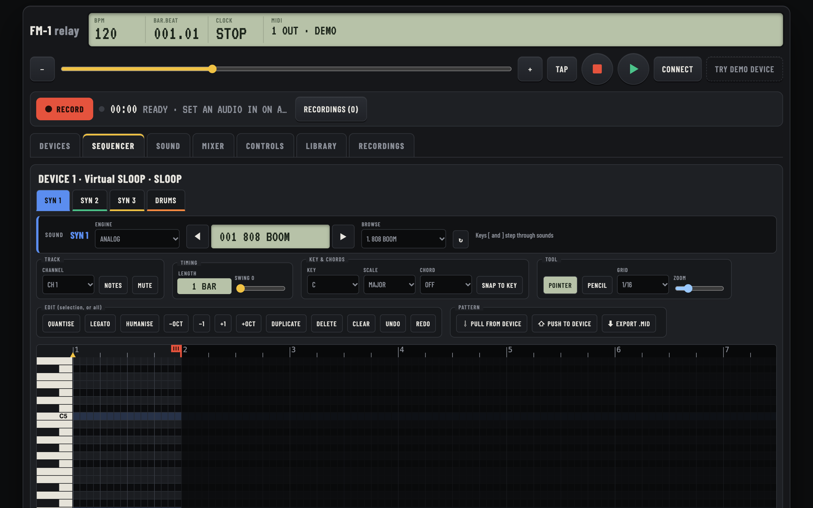
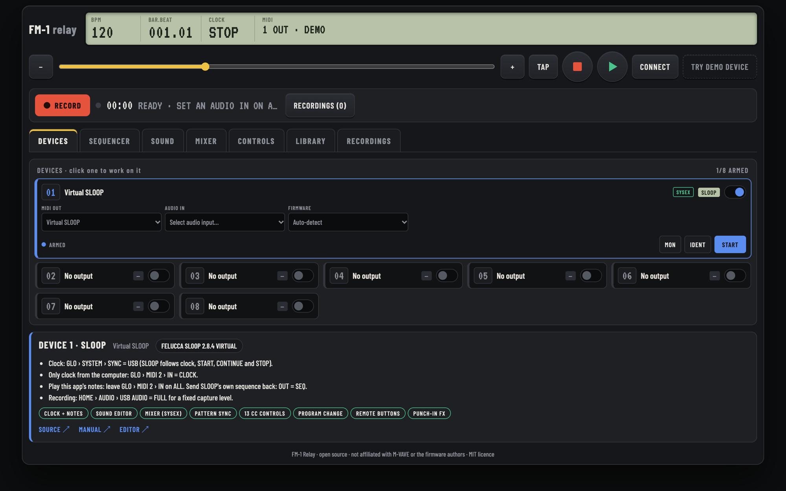

<div align="center">

# FM-1 Relay Studio

**A browser control centre for M-VAVE FM-1s running open-source firmware.**

Clock master, piano-roll sequencer, firmware-aware sound editor, mixer, remote control and multitrack recorder for up
to eight FM-1s, in one static web page.

[**▶ Open the app**](https://philip-bos.github.io/fm1-relay-studio/) · [Try it with a demo device](https://philip-bos.github.io/fm1-relay-studio/?demo)

[](https://github.com/Philip-Bos/fm1-relay-studio/actions/workflows/ci.yml)
[](https://philip-bos.github.io/fm1-relay-studio/)
[](LICENSE)




</div>

It knows the firmwares it talks to. With **SLOOP**, **Felucca**, **Skiff** or **JIANT** it reads and writes the device
itself over their SysEx editor protocol: sounds, mix, patterns, presets and projects. With every firmware it drives the
documented MIDI channels, CCs and Program Change.

> FM-1 Relay Studio is a community project. It is not affiliated with M-VAVE or with the firmware authors.

## Quick start

1. Open **<https://philip-bos.github.io/fm1-relay-studio/>** in Chrome or Edge. They support Web MIDI with SysEx.
2. Press **CONNECT** and allow MIDI with SysEx. No FM-1 at hand? Press **TRY DEMO DEVICE** for a virtual SLOOP.
3. On a device card, pick the FM-1's **MIDI OUT**, and its **AUDIO IN** if you want to record. The firmware is detected
   automatically, and the panel underneath lists the exact menu settings it needs.
4. Set the tempo and press ▶ (or <kbd>Space</kbd>).

> [!NOTE]
> Safari and every browser on iPhone and iPad have no Web MIDI.



## What it does

| Page | What you get | Firmware |
| --- | --- | --- |
| **Devices** | Up to 8 FM-1s. Each gets a MIDI out, an audio in, firmware detection and setup steps for that firmware. | all |
| **Sequencer** | Piano roll and drum grid per track. Scales, one-key chords, quantise, humanise, legato, undo. Step entry and live recording from the on-screen keys, the computer keyboard or any MIDI keyboard. 100 built-in drum grooves plus your own. | all |
| | **Pull from / push to device**: read the FM-1's own step pattern into the roll, or write the roll into it (chords, ties, accents; on SLOOP, drum levels and ratchets). | FL protocol |
| | **Export .mid** of every track. | all |
| **Sound** | Every parameter of every track plus the globals, with engines and presets. **Live**: turn a knob on the FM-1 and the slider follows. | FL protocol |
| **Mixer** | A level, pan and mute strip per track. It mixes on the device over SysEx and follows the device live. Without SysEx it falls back to CC 7 and CC 10. | all |
| **Controls** | The firmware's documented CC map per track, Program Change and bank, drum kits, pitch bend, sustain, a custom CC sender for MIDI LEARN, and panic. **SLOOP**: its 14 buttons by remote and its 27 punch-in effects as pads. | all |
| **Library** | Projects 1–4 and the 32 user presets on the device: load, save, store, erase. **SLOOP**: a full read-only backup to a file. Session export and import. | FL protocol / all |
| **Recordings** | Records each device's USB audio as its own stem, plus a mix. Takes are kept in the browser and never overwritten. | all |

The session (device assignments, firmware choices, tempo, patterns) is saved in the browser automatically.

## Supported firmware

| Firmware | Detection | Editor protocol | CC map | Program Change | Extras |
| --- | --- | --- | --- | --- | --- |
| [SLOOP](https://github.com/isod89/sloop-fm1) 2.8 | INFO | v12: drum lanes, levels, ratchets, backup | ✓ documented | presets, kits, bank | remote buttons, punch-in FX |
| [Felucca](https://github.com/hugelton/Felucca) 1.7 | INFO | v4 | ✓ documented | ✓ | |
| [Skiff](https://github.com/illuminus5/skiff) 2.0 | INFO / port | v4 (6 tracks) | ✓ documented | ✓ | |
| [JIANT](https://github.com/juanjiant-bit/JIANT) | INFO / port | v4 (6 tracks) | assumed (Felucca-based) | | |
| [X0X](https://github.com/charlesvestal/fm1-x0x) | port name | — | — | — | 909 / 808 / 303 / BREAK lanes |
| [ECHOFIELD](https://github.com/Philip-Bos/echofield-fm1) | port name | — | ✓ documented | ✓ | play CC with START / STOP |
| Any other Felucca fork | INFO | v1–v4, built from INFO | | ✓ | |
| Official M-VAVE, anything else | manual | — | custom CC | ✓ | |

[docs/FIRMWARES.md](docs/FIRMWARES.md) has the details and sources. To add a firmware, see
[docs/ADDING_A_FIRMWARE.md](docs/ADDING_A_FIRMWARE.md): it is usually one data file.

## Recording

Firmware with USB audio (SLOOP 2.3+, Felucca, JIANT and others) appears as a class-compliant stereo input. Pick it as
the device's **AUDIO IN** and press **RECORD**. You get one stem per device and a summed mix, as WebM/Opus in Chrome and
Edge or M4A where the browser offers it. Operating systems differ in how many USB audio inputs they open at once. If
yours opens only one, build an aggregate device and record in a DAW.

## Run it locally

Plain HTML, CSS and ES modules. There are no dependencies and no build step.

```sh
git clone https://github.com/Philip-Bos/fm1-relay-studio.git
cd fm1-relay-studio
npm start     # http://localhost:4173 (add ?demo for the virtual device, ?fresh to ignore the saved session)
npm test      # node --test: FL protocol, encodings, step conversion, MIDI files, profiles, module syntax
```

Web MIDI needs a secure context, and `localhost` counts as one. Any static server works (`python3 -m http.server 4173`).
To host your own copy, fork the repository and set **Settings › Pages › Source** to **GitHub Actions**.
[docs/ARCHITECTURE.md](docs/ARCHITECTURE.md) maps the code.

## Contributing

Bug reports, firmware reports and pull requests are welcome. Testing with your own firmware helps most. See
[CONTRIBUTING.md](CONTRIBUTING.md).

## Licence

[MIT](LICENSE). The firmwares are separate projects under their own licences, mostly GPL-3.0. This repository contains
none of their code. It implements their published MIDI and SysEx interfaces.
